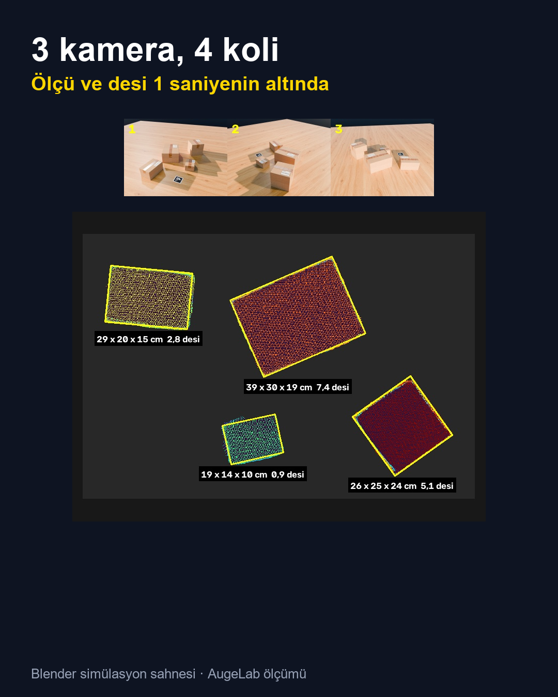
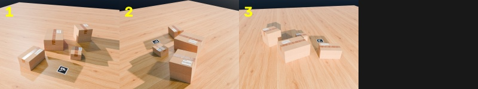
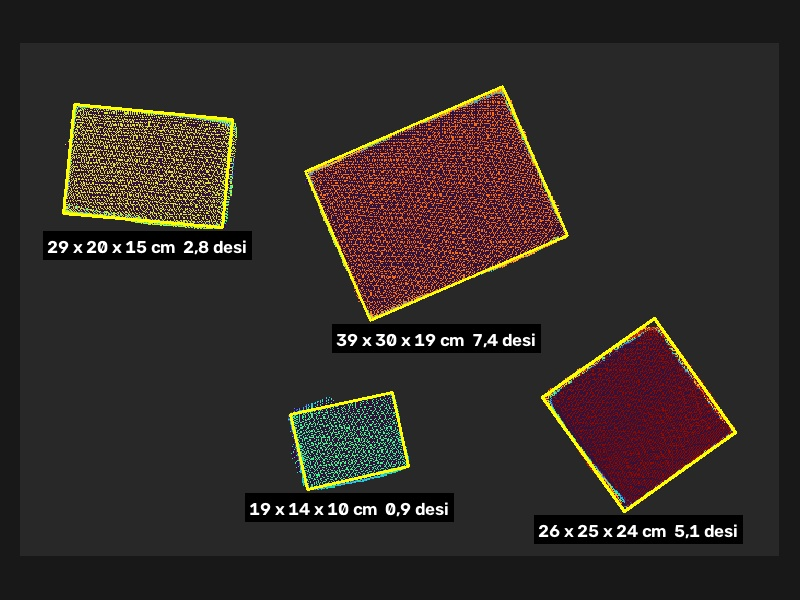
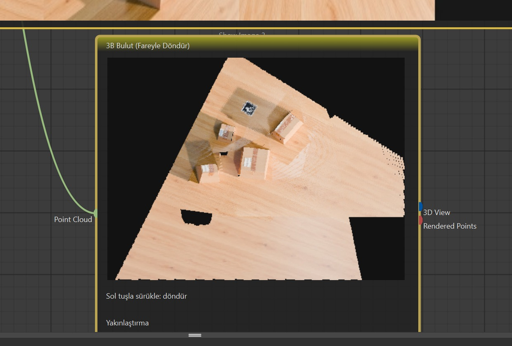
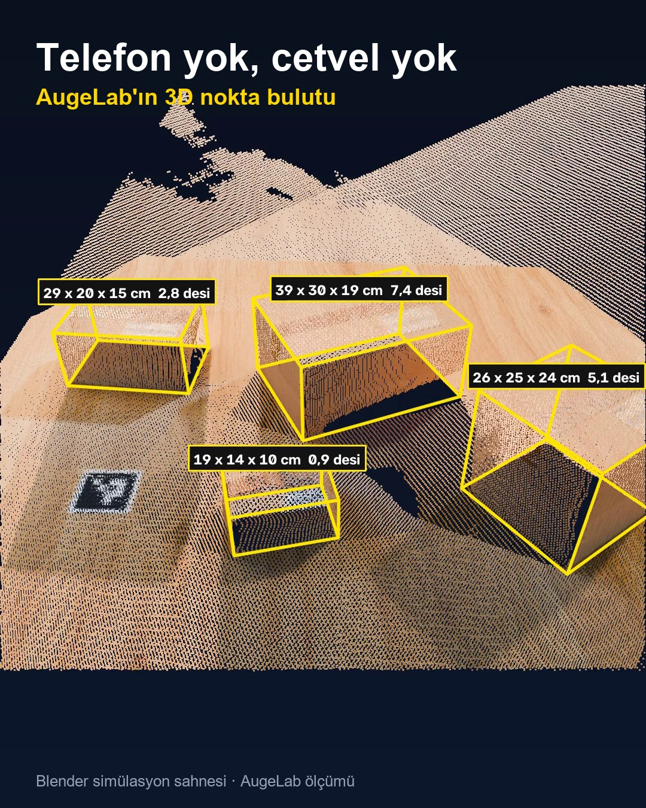

# 3 kamerayla kargo desisi ölçümü

**AugeLab Studio + yerel GPU servisi ile koli ölçüsü (boy × en × yükseklik) ve desi**

Operatör için ana arayüz, servis başladıktan sonra
[tarayıcıda açılan ölçüm ekranıdır](http://127.0.0.1:8770/).
[Studio senaryosu ve yerel HMI](studio/README.md) isteğe bağlıdır.

> **Önemli:** Aşağıdaki tüm sonuçlar ve görseller **Blender'da render edilmiş bir simülasyon sahnesinden**
> alınmıştır. Sistem **gerçek kolilerle henüz doğrulanmadı.** Gerçek kamerada ışık, yansıma, bulanıklık
> ve kalibrasyon farkları nedeniyle hata büyük ihtimalle daha yüksek olacaktır.
>
> **Lisans uyarısı:** Bu depodaki kod MIT lisanslıdır, ancak servis çalışırken indirilen **Pi3X model
> ağırlıkları CC BY-NC 4.0** lisanslıdır, yani **ticari kullanıma izin vermez.** Ayrıntı: [Lisanslar](#lisanslar).

Masanın çevresine yerleştirilen 2–3 sabit kamera aynı anda birer kare çeker. Kareler yerel bir GPU
servisine gider; servis Pi3X modeliyle bunları tek geçişte birleşik bir 3D nokta bulutuna çevirir.
Sahnedeki basılı 100 mm ArUco kart bulutu milimetreye ve masa düzlemine oturtur. Ardından masa
üstündeki her koli ayrılır, boy × en × yükseklik ölçülür ve Türkiye'de kargo fiyatlamasında kullanılan
**desi = (boy × en × yükseklik, cm³) / 3000** hesaplanır. Her şey AugeLab Studio'da sürükle-bırak
bloklarla kurulur; model ve ölçüm kendi bilgisayarında, internete veri göndermeden çalışır.

<p align="center">
  
</p>

<p align="center"><sub>Blender simülasyon sahnesi: üstte 3 kameranın kareleri, altta koli kutuları ve cm/desi etiketleri.</sub></p>

---

## İçindekiler

- [Nasıl çalışır](#nasıl-çalışır)
- [Donanım](#donanım)
- [Kurulum](#kurulum)
- [Kartı yazdırma](#kartı-yazdırma)
- [Kamera yerleşimi](#kamera-yerleşimi)
- [Studio'da kullanım](#studioda-kullanım)
- [HTTP API](#http-api)
- [Doğruluk (Blender testi)](#doğruluk-blender-testi)
- [Bilinen sınırlamalar](#bilinen-sınırlamalar)
- [Lisanslar](#lisanslar)
- [Klasör yapısı](#klasör-yapısı)
- [English summary](#english-summary)

---

## Nasıl çalışır

```
 AugeLab Studio                                              Yerel GPU servisi (service/, 127.0.0.1:8770)
 ─────────────────────────────────────────────               ───────────────────────────────────────────
 Kamera 1 ─┐
 Kamera 2 ─┼─► Çok Kameralı 3D ── 3 JPEG, POST /capture ──►  Pi3X: 3 kare -> tek nokta bulutu
 Kamera 3 ─┘   (MultiCam3D)                                   ArUco kart (100 mm) -> ölçek mm, masa = 0
                    │          ◄── GET /result (mm bulut) ──
                    │
                    ├─► Point Cloud ─► 3D Ölçüm ── POST /measure ──►  masa üstü nesneleri ayır,
                    │                  (Kargo modu) ◄── L×W×H, desi ─  L × W × H, desi = cm³ / 3000
                    │                     ├─► View ─► Show Image (üstten harita + etiketler)
                    │                     └─► Measurements (metin), Objects (liste)
                    │
                    ├─► Point Cloud ─► 3B Bulut (Fareyle Döndür)
                    └─► Preview ─► Show Image (3 kamera karesi)
```

- **Çok Kameralı 3D** (`MultiCam3D`): kameraların aynı andaki karelerini servise yollar. Trigger
  bağlıysa yükselen kenarda çeker; bağlı değilse her "Aralık" saniyede bakar, sahne değiştiyse
  (yeni koli) yeniden hesaplar.
- **GPU servisi** (`service/server.py`): Pi3X ile kareleri tek geçişte birleştirir. Kart en az bir
  kamerada görünüyorsa köşelerinin 3D karşılığı bulunur ve bulut kart eksenlerine oturur: birim mm,
  kart düzlemi = masa = yükseklik 0.
- **3D Ölçüm** (`Measure3D`): masadan yükselen noktaları 2 mm'lik üstten ızgaraya döker, bitişik
  bölgeleri nesne sayar; her nesneye en küçük döndürülmüş dikdörtgeni oturtur (L × W) ve
  yüksekliğin %98'lik değerini H alır. Kargo modunda etiketler cm + desi.

Studio'nun kendi torch'u CPU sürümü olduğu için modeller ayrı bir Python sürecinde (servis) çalışır;
bloklar yalnızca HTTP istemcisidir.

## Donanım

- **NVIDIA GPU, ~8 GB+ VRAM** (CUDA 12.8 uyumlu sürücü). Test: **RTX 5070 Ti Laptop, 12 GB**.
- Windows 10/11, Python 3.12, AugeLab Studio (masaüstü).
- Disk: torch ~3 GB, Pi3X ağırlıkları ~5,4 GB, MoGe-2 ağırlıkları ~1,3 GB (yalnızca Tek görüntü modu kullanılırsa iner).
- 2–3 USB/IP kamera (aynı anda görüntü verebilen), basılı ArUco kart.

## Kurulum

[Windows kurulum ve ilk ölçüm kontrol listesi](docs/KURULUM.md).

1. Depoyu indir (ZIP ya da `git clone`). Studio demo sahnesi görüntüleri
   `C:\augelab-3d-desi\studio\demo\` yolundan okur; ek ayar istemiyorsan depoyu bu klasöre koy:
   `git clone https://github.com/lyunusl/augelab-3d-desi C:\augelab-3d-desi`
2. PowerShell'de depo kökünde:

   ```powershell
   powershell -ExecutionPolicy Bypass -File .\setup.ps1
   ```

   - venv'i **kısa bir yolda** oluşturur: varsayılan `%USERPROFILE%\venvs\desi3d`. Derin klasörlerde
     Windows uzun yol sınırı pip kurulumunu bozuyor. Başka yer için `-Venv C:\venvs\desi3d`.
   - git gerekmez: MoGe, utils3d-moge ve Pi3 GitHub zip arşivlerinden kurulur.
   - Tekrar çalıştırmak güvenlidir (var olan venv ve Pi3 kaynağı yeniden oluşturulmaz).
   - Elle kurulum sırası `requirements.txt` başındaki notlarda.

3. Servisi başlat:

   ```bat
   service\start_server.cmd
   ```

   venv varsayılan yerde değilse önce `set DESI3D_VENV=C:\yol\venv`. İlk açılışta Pi3X ağırlıkları
   Hugging Face'ten iner (~5,4 GB). `hazır: http://127.0.0.1:8770` satırını bekle (sonraki
   açılışlarda ~15 sn). `start_server.cmd` ayrıca Rerun 3D penceresini açar (`--rerun`); istemezsen
   `python service\server.py` ile bayraksız başlat. `.ply` çıktıları `out\pointcloud\` altına
   yazılır (`--out` ya da `DESI3D_OUT` ile değişir).

4. Blokları Studio'ya kopyala ve **Studio'yu yeniden başlat** (bkz. [studio_blocks/README.md](studio_blocks/README.md)):

   ```powershell
   $blockFolder = Join-Path $env:APPDATA 'AugeLab Studio\marketplace\custom_blocks'
   New-Item -ItemType Directory -Force -Path $blockFolder | Out-Null
   Copy-Item .\studio_blocks\*.py -Destination $blockFolder
   ```

## Kartı yazdırma

[`card/aruco_kart_100mm_A4.pdf`](card/aruco_kart_100mm_A4.pdf) dosyasını **%100 / Gerçek boyut**
ölçekle yazdır ("Sayfaya sığdır" kapalı). Ortadaki siyah kare tam **100 mm** olmalı; kartın
altındaki 10 cm çizgisini cetvelle kontrol et. Mat kâğıt kullan, kartı düz tut (kartona yapıştır).
Ölçü farklı çıktıysa Studio'daki "Kart boyu (mm)" ayarına ölçtüğün değeri yaz.
Kart: ArUco `DICT_4X4_50`, id 0. Yeniden üretmek için: [card/README.md](card/README.md).

## Kamera yerleşimi

```
              Kamera 1
                 ▼
            ┌─────────┐
            │  koli   │  [kart]
 Kamera 3 ► │  koli   │ ◄ Kamera 2      kameralar arası ≈120°
            └─────────┘
```

- Masanın çevresinde **≈120° aralıklı** 3 kamera.
- Masaya **1–1,5 m** uzaklık, **40–50° yukarıdan** aşağı bakış.
- Kart masada, koliler gibi aynı düzlemde ve **en az bir kameradan** görünür olmalı.
- Kameralar ortak alanı (koliler) görmeli; kurulumdan sonra kameraları oynatma.
- Kolileri birbirine değdirmeden, arada birkaç cm boşlukla koy.

## Studio'da kullanım

1. Servisi başlat, `hazır` satırını bekle.
2. Studio'da yeni senaryo aç. 3 adet kamera bloğu (ör. **Camera USB**) ekle, her birine bir kamera seç.
3. **Çok Kameralı 3D** bloğunu ekle; kamera çıkışlarını **Kamera 1**, **Kamera 2**, **Kamera 3** girişlerine bağla.
   - Kart boyu (mm): `100` (0 = ölçekleme yok; ölçüm için kart şart).
   - Aralık (sn): `2` — Trigger bağlı değilse bu sıklıkla bakar, sahne değiştiyse yeniden hesaplar.
   - İstersen **Logic Input** → **Trigger**: anahtarı açınca bir kez çeker (kapatıp açınca yeniden).
4. **3D Ölçüm** bloğunu ekle; **Point Cloud** çıkışını onun **Point Cloud** girişine bağla.
   **Kargo modu (cm + desi)** kutusunu işaretle. "Masadan en az yükseklik (mm)" varsayılan `8`.
5. **3D Ölçüm → View** çıkışını bir **Show Image** bloğuna bağla (üstten harita, kutular, etiketler).
   **Measurements** satır satır `1: 39 x 30 x 19 cm · 7,3 desi` biçiminde metin verir;
   **Objects** listesi `[{id, L, W, H (mm), desi, x, y, area_mm2}]`.
6. İsteğe bağlı: **Çok Kameralı 3D → Preview** → Show Image (3 kamera karesi),
   **Point Cloud** → **3B Bulut (Fareyle Döndür)** (sol tuşla sürükle: döndür, Yakınlaştırma slider'ı).
7. Senaryoyu çalıştır. **Status** çıktısında `3 kare · ... ms · ... nokta · mm (kart N karede, köşe hatası X mm)`
   görmelisin. "kart bulunamadı, ölçek göreli" yazıyorsa kart hiçbir kamerada algılanmadı.

<p align="center">
  <br>
  <br>
  
</p>
<p align="center"><sub>Blender simülasyon sahnesi: Preview, 3D Ölçüm View ve Studio içindeki 3B bulut görünümü.
Görseldeki etiketler ayrı bir çalıştırmadan; tablodaki değerlerden ±0,1 desi farklı olabilir.</sub></p>

**3D Nokta Bulutu** (`PointCloud3D`) bloğu aynı servisi tek kamerayla kullanır: *Canlı* (kamerayı
gezdirdikçe bulut büyür, Trigger `.ply` kaydeder), *Tek görüntü* (MoGe-2), *Çok açı* (tek kamerayla
2–8 farklı açıdan kare toplar ya da bir klasörü okur). Kargo hattı için gerekmez.

<p align="center">
  
</p>

### Studio'suz araçlar (`service/`)

- `live_pc.py` — webcam'i gezdirerek canlı 3D bulut, Rerun penceresinde (`--cam 0`, `--video dosya.mp4`).
  Kamera penceresi: `q` kaydet + çık, `s` `.ply` kaydet, `r` sıfırla.
- `render_orbit.py` — 3 kamera görüntüsünden ölçü kutulu 360° dönüş videosu (9:16). Servis açık olmalı,
  **ffmpeg** PATH'te olmalı: `python render_orbit.py k1.png k2.png k3.png --out orbit.mp4`.

## HTTP API

Servis yalnızca `127.0.0.1:8770` dinler (`--host`, `--port`). Kimlik doğrulama yoktur; ağa açma.
Bulut biçimi (ikili): N × (3 float32 xyz, 3 uint8 rgb); eksenler x sağ, y yukarı, z ileri.
mm ölçekli bulutta kart düzlemi y = 0. Tam sözleşme `service/server.py` başında.

| Uç nokta | Gövde | Yanıt |
|---|---|---|
| `POST /capture?sid=..&marker=100&save=0\|1` | Art arda JPEG'ler, başlık `X-Sizes: n1,n2,..` (2–8 sabit kamera) | `{"status","points","version","ply"}` |
| `GET /result?sid=..&max=N` | — | Oturumun bulutu (ikili, başlık `X-Points`) |
| `GET /result_preview?sid=..` | — | Önizleme JPEG (kamera kareleri) |
| `POST /measure?min_h=8&cell=2&cargo=0\|1` | mm bulut (ikili) | `{"objects":[{id,L,W,H,x,y,area_mm2,desi}], "image": base64 JPEG}` |
| `POST /process?sid=..&mode=live\|single\|multi&...` | JPEG ya da boş | 3D Nokta Bulutu bloğunun tek giriş noktası |
| `POST /single?max=N&save=1` | Tek JPEG | Bulut (MoGe-2) |
| `POST /multi?max=N&save=1` | JPEG'ler + `X-Sizes` (2–8) | Bulut (Pi3X, tek geçiş) |
| `POST /frame`, `GET /status`, `GET /preview`, `GET /cloud?max=N`, `POST /reset`, `POST /save` | — | Canlı mod |

`sid`: blok örneği başına oturum. L, W, H mm; `desi = L·W·H / 1000 / 3000` (bir ondalık).

Örnek (PowerShell değil, Python):

```python
import json, urllib.request
bufs = [open(p, "rb").read() for p in ("k1.jpg", "k2.jpg", "k3.jpg")]
req = urllib.request.Request("http://127.0.0.1:8770/capture?sid=test&marker=100", data=b"".join(bufs),
                             method="POST", headers={"X-Sizes": ",".join(str(len(b)) for b in bufs)})
print(json.loads(urllib.request.urlopen(req, timeout=120).read())["status"])
cloud = urllib.request.urlopen("http://127.0.0.1:8770/result?sid=test&max=5000000").read()
res = json.loads(urllib.request.urlopen(urllib.request.Request(
    "http://127.0.0.1:8770/measure?cargo=1", data=cloud, method="POST")).read())
for o in res["objects"]:
    print(o["id"], o["L"], o["W"], o["H"], "mm", o["desi"], "desi")
```

## Doğruluk (Blender testi)

> Sentetik sahne. Gerçek fotoğrafta hata büyük ihtimalle daha yüksek olur.

**Gerçekçi 4 kolili Blender sahnesi**, 3 kamera (6 açılık halkadan 0., 2. ve 4. açılar):

| Koli (gerçek) | Ölçülen | Fark L / W / H (mm) |
|---|---|---|
| 40×30×20 cm, 8,0 desi | 39×30×19 cm, 7,3 desi | −8 / −5 / −10 |
| 25×25×25 cm, 5,2 desi | 26×25×24 cm, 5,1 desi | +6 / 0 / −10 |
| 30×20×15 cm, 3,0 desi | 29×20×15 cm, 2,8 desi | −11 / −2 / −5 |
| 20×15×10 cm, 1,0 desi | 19×14×10 cm, 0,9 desi | −10 / −11 / −3 |

- 12 ölçünün hepsi **±11 mm** içinde, ortalama mutlak hata **≈6,7 mm**.
- Ölçüm sistematik olarak birkaç mm **küçük** → desi tipik olarak **%5–10 düşük** (bu testte %2–10).

**Basit nesne sahnesi** (3D Nokta Bulutu bloğu, 100 mm kart):

| Nesne (gerçek, mm) | Çok açı (6 kare) | Tek görüntü |
|---|---|---|
| Kutu 120×80×60 | 118×79×59 | 128×81×58 |
| Silindir Ø60×100 | 57×56×100 | 56×45×109 |
| Uzun kutu 50×50×150 | 53×50×145 | 62×54×146 |

Kart köşe hatası: çok açı 3,7 mm, tek görüntü 1,5 mm. Ölçüm için çok açı önerilir.

**Hız** (RTX 5070 Ti Laptop): çok açı 6 görüntü ~1 sn, 8 görüntü ~4 sn. Canlı mod (640×480):
adım ~0,5 sn, ~8 keyframe/sn.

## Bilinen sınırlamalar

- **Gerçek kolilerle doğrulanmadı.** Tüm sayılar Blender simülasyonundan.
- **Sistematik küçük ölçme:** kenarlar birkaç mm kısa çıkıyor, desi %5–10 düşük olabilir. Kargo
  fiyatlandırması için kullanmadan önce kendi kolilerinle kalibre et/doğrula.
- **6 açılı çalıştırma 4 kolili sahnede başarısız oldu** (köşe hatası 13,5 mm, fazladan nesneler);
  nedeni araştırılmadı. 3 kamera önerilir.
- **Kart en az bir kamerada görünmeli**; görünmezse ölçek göreli kalır ve 3D Ölçüm nesne bulamaz.
- **Windows'ta flash attention yok:** `service/recon.py`, Pi3'ün bf16'da zorunlu kıldığı flash
  attention yerine efficient / cuDNN / math arka uçlarını kullanacak şekilde Pi3'ün iç modülünü
  (`pi3.models.layers.attention`) yamalar. Pi3 `main` dalından sabitlenmeden kurulduğu için ileride
  Pi3 değişirse bu yama ya da import'lar bozulabilir. MoGe de `main` dalından kurulur.
- **Tek canlı oturum:** canlı rekonstrüksiyon serviste tektir; aynı anda yalnızca bir blok Canlı modda
  kullanılmalı. Tek seferlik istekler GPU'yu sırayla kullanır.
- **Yalnızca kutu benzeri nesneler:** ölçüm üstten en küçük dikdörtgen + yükseklik verir; silindir vb.
  için sınırlayıcı kutu çıkar. Birbirine ~1 cm'den yakın koliler tek nesne olarak birleşebilir.
- **VRAM:** canlı modda `--pixels` ~120k üstüne çıkınca 12 GB taşıyor ve adımlar ~8x yavaşlıyor (varsayılan 92k).
- Servis kimlik doğrulamasızdır, yalnızca yerel makinede (`127.0.0.1`) çalıştır.
- `card/make_card.py` Windows'taki Arial fontunu kullanır; `render_orbit.py` için ffmpeg gerekir.

## Lisanslar

> **Kısa cevap:** Bu depodaki kodu kullanabilir, değiştirebilir ve satabilirsin (MIT). Ancak sistem
> çalışırken **Pi3X model ağırlıklarını** indirir ve kullanır; bunlar **CC BY-NC 4.0** lisanslıdır ve
> **ticari kullanıma izin vermez.** 3 kameralı kargo/desi hattı (Çok Kameralı 3D), Çok açı ve Canlı
> modları Pi3X'e bağlıdır; servis açılışta Pi3X'i her durumda yükler. Bu haliyle ticari kullanım için
> Pi3X yerine ticari lisanslı bir model koymak ya da Pi3 yazarlarından izin almak gerekir.
> Bu bölüm hukuki tavsiye değildir.

| Bileşen | Lisans | Ticari kullanım | Kaynak |
|---|---|---|---|
| Bu depo (servis, bloklar, kart, belgeler) | MIT | Evet | [`LICENSE`](LICENSE) |
| Pi3 / Pi3X **kodu** ([yyfz/Pi3](https://github.com/yyfz/Pi3)) | BSD 3-Clause | Evet | Pi3 deposu `LICENSE` ve `README.md` "License" bölümü |
| **Pi3X ağırlıkları** ([yyfz233/Pi3X](https://huggingface.co/yyfz233/Pi3X)) | **CC BY-NC 4.0** | **Hayır** ("Strictly Non-Commercial") | Pi3 `README.md` "License" bölümü; Hugging Face model kartı `license: cc-by-nc-4.0` |
| MoGe **kodu** ([microsoft/MoGe](https://github.com/microsoft/MoGe)) | MIT; `moge/model/modules/dinov2` Apache 2.0 | Evet | MoGe paketi `LICENSE`, `METADATA` (`License-Expression: MIT`) |
| MoGe-2 ağırlıkları ([Ruicheng/moge-2-vitl-normal](https://huggingface.co/Ruicheng/moge-2-vitl-normal)) | MIT | Evet (model kartına göre) | Hugging Face model kartı `license: mit` |
| Pi3 içindeki DINOv2 kodu (`pi3/models/dinov2`) | Apache 2.0 | Evet | Dosya başlıkları (Meta Platforms) |
| utils3d-moge | MIT | Evet | Paket `METADATA` / `LICENSE` |
| PyTorch / torchvision | BSD-3-Clause / BSD | Evet | Paket `METADATA` |
| opencv-python | Apache 2.0 | Evet | Paket `METADATA` |
| rerun-sdk | MIT veya Apache 2.0 | Evet | Paket `METADATA` |
| huggingface-hub, safetensors | Apache 2.0 | Evet | Paket `METADATA` |
| einops | MIT | Evet | Paket `METADATA` |
| plyfile | **GPLv3+** | Koşullu (copyleft) | Paket `METADATA`. Yalnızca Pi3'ün `pi3/utils/basic.py` yardımcısı kullanır; bu servis içe aktarmaz (`.ply` yazıcı kendi kodumuz). |
| three.js (`service/web/vendor/three/`) | MIT | Evet | [`service/web/vendor/three/LICENSE`](service/web/vendor/three/LICENSE) |
| AugeLab Studio | Ayrı, kendi lisans koşulları | — | Bu depoya dahil değildir |

Notlar:
- `LICENSE` (MIT) yalnızca bu depodaki kendi kodumuzu kapsar. Tarayıcı ekranı için three.js kendi MIT
  lisansıyla depoda bulunur; diğer üçüncü taraf kod ve ağırlıklar depoya **dahil edilmemiştir**,
  `setup.ps1` ve servis bunları kaynaklarından indirir. Her biri kendi lisansıyla gelir.
- Pi3 README'sine göre ağırlık kısıtı eğitim verisinin doğasından kaynaklanıyor ve ağırlıklar yeniden
  dağıtılırken bu kısıt korunmalı.
- Lisanslar değişebilir; kullanmadan önce kaynak depoları ve model kartlarını kontrol et.

## Klasör yapısı

```
service/          GPU servisi: server.py (HTTP), recon.py (Pi3X canlı), oneshot.py (MoGe-2 / Pi3X tek geçiş),
                  session.py (blok oturumları, /capture), measure.py (ArUco ölçek, ölçüm, desi),
                  live_pc.py, render_orbit.py, start_server.cmd
service/web/      Tarayıcı ölçüm ekranı (http://127.0.0.1:8770/): 3 kamera, Ölç, koli tablosu, 3D görünüm
studio_blocks/    AugeLab Studio özel blokları (4 adet) + kopyalama notu
card/             100 mm ArUco kart (PDF/PNG) + make_card.py
docs/images/      README görselleri (Blender simülasyon sahnesi)
studio/           Studio senaryosu (.pmod), isteğe bağlı HMI ve Blender örnekleri
setup.ps1         Windows kurulumu
requirements.txt  Bağımlılıklar ve elle kurulum sırası
```

---

## English summary

**Parcel dimensions and Turkish volumetric weight ("desi" = cm³ / 3000) from 2–3 fixed cameras.**
Cameras placed around a table (~120° apart, 1–1.5 m away, looking 40–50° down) grab simultaneous
frames. Custom blocks for the AugeLab Studio desktop app send them to a local GPU service, which fuses
them in a single pass with **Pi3X** into a point cloud. A printed 100 mm ArUco card (DICT_4X4_50, id 0)
scales the cloud to millimetres and aligns it to the table plane; the *3D Ölçüm* (3D Measure) block
then segments each parcel and reports L × W × H and desi.

- **Requirements:** Windows, Python 3.12, NVIDIA GPU with ~8 GB+ VRAM (tested on RTX 5070 Ti Laptop 12 GB), AugeLab Studio.
- **Install:** `powershell -ExecutionPolicy Bypass -File .\setup.ps1` (creates a venv in a short path,
  default `%USERPROFILE%\venvs\desi3d`), then `service\start_server.cmd`, then copy `studio_blocks\*.py`
  to `%APPDATA%\AugeLab Studio\marketplace\custom_blocks\` and restart Studio.
- **Card:** print `card/aruco_kart_100mm_A4.pdf` at 100 % scale; verify the black square is 100 mm.
- **Accuracy (Blender simulation only, not validated on real parcels):** 4 parcels, 3 cameras, all
  dimensions within ±11 mm, mean absolute error ≈6.7 mm; dimensions read slightly small, so desi tends
  to be 5–10 % low. A 6-camera run on the same scene failed.
- **Licensing:** this repository is MIT. **The Pi3X model weights downloaded at runtime are
  CC BY-NC 4.0 (non-commercial).** The 3-camera pipeline depends on them, so commercial use requires
  replacing Pi3X or obtaining permission from its authors. Pi3 code is BSD 3-Clause; MoGe code and the
  MoGe-2 weights are MIT. See the [Lisanslar](#lisanslar) table. Not legal advice.
